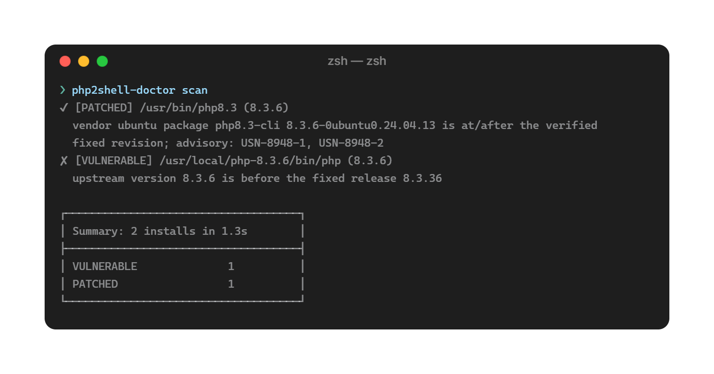

# php2shell-doctor

[](LICENSE)

<p align="center">
  
</p>

php2shell-doctor is the safe checker for the **php2shell** PHP vulnerabilities ([CVE-2026-109618](https://github.com/php/php-src/security/advisories/GHSA-w8hw-w9fx-j79w), [CVE-2026-109619](https://github.com/php/php-src/security/advisories/GHSA-6wmf-4rv5-p3rp)). 
It tells you whether your PHP is patched, running old code, misconfigured, or already exploited. 
No exploit probes, no network access.
It works both for enterprises with hundreds of servers and for one WordPress instance in the closet. 
Single static binary, zero dependencies.

## What this does

- **Classifies every PHP runtime on the host** — PATH, distro packages (dpkg/rpm/apk), cPanel, Plesk, LiteSpeed, Homebrew/scoop, Docker containers and images.
- **Vendor-backport aware** — ships a versioned database of distro fixes (Ubuntu revisions, Debian DSA/DLA, RHEL errata policy, Alpine, remi, sury, official images) with real dpkg/rpm comparison. Unverifiable cases report `VERIFY_VENDOR`, never a silent "safe".
- **Finds the patch gap that isn't a version** — detects workers still running pre-upgrade code (`PATCHED_STALE_WORKERS`) across Linux, macOS and Windows.
- **Audits the config surface** — `session.upload_progress` (CVE-2026-109619 + the unpatched CVE-2026-115560), `memory_limit` OOM trigger, per-directory `.user.ini`/`.htaccess` and FPM pool overrides.
- **Looks up appliances** — is your ClearPass/ONTAP/SEPM affected? (`product -q`, from the NCSC-NL 751-product inventory.)
- **Hunts for exploitation** — scans logs for the documented attack signatures; ingests [assetnote/php2shell-scanner](https://github.com/assetnote/php2shell-scanner) JSON to reconcile remote probes with local facts.
- **Mitigates safely** — applies PHP's temporary ini mitigations as a dry-run-default, rollback-able drop-in.

| Command | Purpose |
|---|---|
| `scan` | discover PHP installs, classify patch state, audit config, optional `--hunt`/`--docker`/`--remote-json` |
| `mitigate` | apply/remove temporary ini mitigations (dry-run by default) |
| `product -q NAME` | look up appliances in the NCSC-NL inventory |
| `db` | show vendor-fix database revision |
| `self-test` | verify engine consistency after install |

## Installation

**Option 1 — install with Go** (needs [Go 1.22+](https://go.dev/doc/install)):

```bash
go install github.com/php2shell-doctor/php2shell-doctor/cmd/php2shell-doctor@latest
```

**Option 2 — build from source:**

```bash
git clone https://github.com/php2shell-doctor/php2shell-doctor
cd php2shell-doctor
go build -o php2shell-doctor ./cmd/php2shell-doctor
```

Then verify the install — every engine self-checks:

```bash
php2shell-doctor self-test
```

No dependencies beyond the Go toolchain. Runs on Linux, macOS and Windows.

## Usage

```bash
php2shell-doctor scan                 # verdicts + config findings
php2shell-doctor scan --hunt          # + exploitation signatures in logs
php2shell-doctor scan --docker --docker-exec   # + containers, real versions inside
php2shell-doctor mitigate             # temporary mitigations plan (dry run)
```

```console
$ php2shell-doctor scan
✔ [PATCHED] /usr/bin/php8.3 (8.3.6)
  vendor ubuntu package php8.3-cli 8.3.6-0ubuntu0.24.04.13 is at/after the verified
  fixed revision; advisory: USN-8948-1, USN-8948-2
✘ [VULNERABLE] /usr/local/php-8.3.6/bin/php (8.3.6)
  upstream version 8.3.6 is before the fixed release 8.3.36
  - CFG-UPLOADPROGRESS-ON [high] session.upload_progress is enabled
┌────────────────────────────────────┐
│ Summary: 2 installs in 1.3s        │
├────────────────────────────────────┤
│ VULNERABLE              1          │
│ PATCHED                 1          │
└────────────────────────────────────┘
```

Note the first line: upstream 8.3.6, **correctly PATCHED** through Ubuntu's
revision backport — the false positive that defeats every version-only checker.

## Exit codes

| Code | Meaning | What to do |
|---|---|---|
| `0` | Everything patched | Nothing — you're done |
| `1` | At least one PHP is vulnerable, end-of-life, or running workers that predate the patch | Update PHP or restart its workers |
| `2` | Patch state could not be proven (vendor backport or unknown version) | A human must confirm against the cited vendor advisory |
| `3` | The scan itself failed | Fix the invocation (see the error message) |

Output formats: human-readable text with colors in a terminal, or machine-readable
`--json`, `--csv`, `--sarif`, `--cyclonedx` for CI and asset tooling.

## Learn more

**[Full usage guide →](docs/USAGE.md)**

**[FAQ →](FAQ.md)**

## Contact

andrey@paxintelligence.com

## License

Apache-2.0
